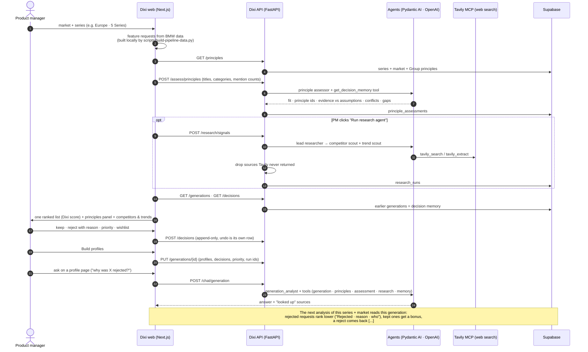

<p align="center">
  
</p>

<p align="center"><b>Hear every market. Decide with a reason.</b></p>

<p align="center">
  <a href="https://dixi-wheat.vercel.app"></a>
  <a href="https://vimeo.com/1234768287?fl=ip&fe=ec"></a>
</p>

<p align="center">
  
  
  
  
  
  
  
  
</p>

---

**Dixi** helps BMW product managers decide what the next 1, 5 or 7 Series should offer in Europe, the USA and China. It reads what customers in a market ask for, checks it against BMW's principles[...]

*Named after the Dixi 3/15, BMW's first car (1928).*

## How Dixi thinks: three layers

| | Layer | What goes in | How it counts |
|---|---|---|---|
| 🟦 | **L1 · BMW principles** | 53 principles in Supabase: 9 series fundamentals (3 per series, owned by named teams), 34 market principles (Europe, UK, China, USA) and 10 BMW Group principles[...] | Strongest: a hard guardrail |
| 🔵 | **L2 · Market evidence** | BMW's customer feedback (as feature requests with mention counts per market), customer studies, sales, today's option list, plus competitor features and trends[...] | Main signal |
| 🩵 | **L3 · Social test** | After profiles exist: which profile would track better on social media. **Simulated** (no social-media integration). | Weakest, fixed per series: 7 Series 2 %, 5 Series 3 %, 3 Series 5 % |

**Dixi score** (0–100, per feature request): `100 × (wD·demand + wB·market backing + wF·principle fit) / (wD + wB + wF)`, then **decision memory**. A past reject lowers it by `penalty × 0.5[...]`

## The workflow, end to end



## When each analysis runs

After the PM picks a market and a car, **the principle assessor runs live**. The other inputs were analysed earlier and the screen says so:
- **BMW data:** prepared by the data script, rule-based, run by hand when new data arrives.
- **Competitors and trends:** the last stored run of the research agent, or the saved research. The agent itself runs when the PM clicks **Run research agent**.

**Monthly refresh job (built, scheduled run off):** `backend/scripts/monthly_refresh.py` labels each customer comment with the **OpenAI Decisions API** (request, category and type with a confidenc[...]

## What works today, and where

| Claim | Status | Code |
|---|---|---|
| BMW data → feature requests per market (taxonomy clusters, mention counts, studies, sales, option list) | ✅ deterministic script, no LLM, no network | [`scripts/build-pipeline-data.py`](scripts/build-pipeline-data.py) |
| L1 principles stored and served per series + market (Europe includes the UK) | ✅ Supabase | [`supabase/migrations`](supabase/migrations), [`backend/scripts/seed_principles.py`](backend/scripts/seed_principles.py) |
| Principle assessor: fit per request, cited ids, evidence vs assumptions, conflicts, gaps | ✅ runs in the analysis step; unknown ids dropped | [`backend/app/agents/principles.py`](backend/app/agents/principles.py) |
| Research agent: competitors + trends with checked sources and gaps | ✅ lead + 2 scout sub-agents on Tavily MCP | [`backend/app/agents/research.py`](backend/app/agents/research.py), [`web/src/components/pipeline`](web/src/components/pipeline) |
| Dixi score with decision memory, settings by sliders or plain words, change log | ✅ | [`scoring.ts`](web/src/lib/pipeline/scoring.ts), [`WeightsAssistant.tsx`](web/src/components/dashboard/WeightsAssistant.tsx) |
| Decisions with who · when · reason; reject needs a reason (UI, API and database) | ✅ append-only history | [`decision-log.ts`](web/src/lib/pipeline/decision-log.ts), `POST /decisions` |
| Generations saved and read back as memory by the next generation | ✅ | [`sessions.ts`](web/src/lib/pipeline/sessions.ts), `PUT /generations`, `GET /memory` |
| 3 car profiles, L1 = principle fit + PM priority, tensions listed, PDF via print | ✅ | [`profiles.ts`](web/src/lib/pipeline/profiles.ts), [`Profiles.tsx`](web/src/components/pipeline/Profiles.tsx) |
| Evidence page per profile: every requirement with exact references (BMW record ids, study workbook cells, option codes, source URLs, principle ids, decision), filterable by source | ✅ | [`evidence`](web/src) |
| Ask questions about a generation on the profile page; answers only from retrieved facts, with what was looked up | ✅ generation chat | [`backend/app/agents/chat.py`](backend/app/agents/chat.py) |
| L3 social test | 🟡 simulated, labelled in the UI | [`analytics.ts`](web/src/lib/pipeline/analytics.ts) |
| Monthly refresh: label comments (OpenAI Decisions API), count demand, research + assess, report (cron) | ✅ job + tests (live Decisions run on fictional comments: request 12/12); 🟡 schedule[...] | |
| Gates G1–G4, engineering/BOM check, Codebeamer export, postpone, side-by-side generation compare | ⚪ target design only | [`docs/architecture/05-hitl-map.md`](docs/architecture/05-hitl-map.md) |

**Honest by design.** Each agent returns what it could not find (`gaps`), and the principle assessor lists conflicts instead of averaging them away. Markets without comments fall back to all mark[...]

**Data boundary.** BMW customer data never leaves the machine: no verbatims or quotes go to OpenAI, Tavily or Supabase. The agents get our own request titles, categories and mention counts. Detai[...]

## Run it

**Web only** (example data, everything stored in the browser):
```bash
cd web && pnpm install && pnpm dev            # http://localhost:3000
```

**Full stack** (agents + Supabase):
```bash
# 1. keys in the repo-root .env (git-ignored): OPENAI_API_KEY, TAVILY_API_KEY
#    and backend/.env: SUPABASE_URL + SUPABASE_SERVICE_ROLE_KEY (see backend/.env.example)
supabase link --project-ref <ref> && supabase db push        # schema (supabase/migrations)
cd backend && uv sync
uv run python -I scripts/seed_principles.py                  # L1 principles (reads data/L1_Files locally)
uv run fastapi dev                                           # http://127.0.0.1:8000/docs
# 2. web: web/.env.local → NEXT_PUBLIC_API_URL=http://localhost:8000
cd ../web && pnpm dev
```
Tests: `cd backend && uv run pytest -q` (offline: fake models, fake search, in-memory store) · `cd web && pnpm lint && pnpm exec tsc --noEmit`. The live site **https://dixi-wheat.vercel.app** ru[...]

## What's in the repo

| Folder | What |
|---|---|
| [`web/`](web/) | The app: landing page with a market globe, the requirement pipeline, generations dashboard, settings |
| [`backend/`](backend/) | FastAPI API: research agent, principle assessor, store for principles, decisions, generations, settings |
| [`supabase/`](supabase/) | Database schema (migrations) |
| [`docs/`](docs/) | Setup, architecture diagrams (Mermaid), tech stack |
| [`scripts/`](scripts/) | Local BMW data build for the pipeline, image generation |
| [`branding/`](branding/) | Logo, colours, brand guide |

---

<sub>Built for the BMW challenge "AI for Product Decision Making" at the EHL Hackathon, Munich, October 2026. Dixi is a hackathon project and is not affiliated with BMW. Market principles come fr[...]
